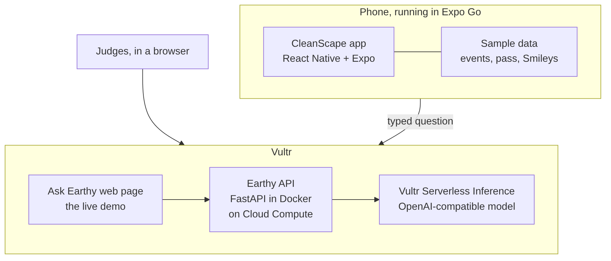

# CleanScape

A bilingual (English and Arabic) app that makes it easy for UAE residents to join community clean-ups, with **Earthy**, an AI helper that answers their questions in plain words.

Built for **HackGlobal 2026** (Polaris School of Technology, powered by Vultr). Track: **Civic and real-world impact**.

- Live demo (Earthy, running on Vultr): `http://YOUR_SERVER_IP` <!-- replace after deploy -->
- Architecture: [docs/architecture.png](docs/architecture.png)



## The problem

People want to help keep their neighbourhood clean but drop out over small unknowns: where do I go, what do I bring, is it safe in the heat, which bin does this go in. Organisers answer the same questions by hand.

## What it does

- Find and join clean-ups, check in with a QR pass, log bags, earn verified hours and Smileys rewards.
- Report litter, learn how to sort waste, host a clean-up.
- **Ask Earthy**: type a question and get a short, honest answer about sorting waste, heat safety and your next clean-up, in English or Arabic.

## How we use Vultr

| Vultr product | What it does here |
| --- | --- |
| **Serverless Inference** | The language model behind Earthy. The server calls Vultr's OpenAI-compatible API. |
| **Cloud Compute** | Hosts the Earthy server (FastAPI in Docker) and the public Ask Earthy web page. |

The phone app and the web page both call the same server: `POST /api/chat`.

## What is real and what is sample data

Honest scope, so nobody is misled:

- **Live:** Earthy's typed chat (app and web page) calls a real model on Vultr.
- **Sample data:** events, the volunteer's pass, hours, Smileys and friends are demo data inside the app. There is no user database yet.
- **Scripted:** Earthy's voice mode and photo scan are designed flows, not live AI yet.
- Earthy is told not to invent facts. If the server is unreachable it says so instead of guessing.

## What existed before the hackathon, and what was built during it

- **Before:** the product idea, user research, the Figma designs, the design system and an earlier app prototype built from those designs. The organisers confirmed by call that this is fine as long as the submission is a fresh repository.
- **During HackGlobal (14 to 15 Nov 2026):** this repository, a rebuild of the app screens against the updated designs, the Earthy server, the Vultr deployment and the live Earthy chat screen.

## Repository layout

```
app/      Expo (React Native) phone app
server/   Earthy API + Ask Earthy web page (FastAPI, Docker)
deploy/   Step-by-step Vultr deploy guide
docs/     Architecture diagram, submission checklist
```

## Run it

**Server**

```bash
cd server
cp .env.example .env      # add your Vultr Serverless Inference key and model
pip install -r requirements.txt
uvicorn main:app --reload --port 8000
```

Open http://localhost:8000. To put it online, follow [deploy/deploy-on-vultr.md](deploy/deploy-on-vultr.md).

**App**

```bash
cd app
npm install
cp .env.example .env      # set EXPO_PUBLIC_EARTHY_API_URL to your server address
npx expo start            # scan the QR code with Expo Go
```

Without the address set, the app still runs and Earthy uses its scripted demo.

## Tech stack

React Native, Expo, expo-router, TypeScript · Python, FastAPI, Docker · Vultr Cloud Compute, Vultr Serverless Inference

## Team

- Nitin Bahukhandi (design and build)

## Credits

- Server and deploy guide adapted from the [HackGlobal starter kit](https://github.com/shubhamupadhyay-pixel/hackglobal-starter) (MIT).
- Built with help from AI coding tools (Claude).
- EEG (Emirates Environmental Group) is the intended community partner; this is a hackathon prototype, not an official EEG product.

## License

MIT. See [LICENSE](LICENSE).
